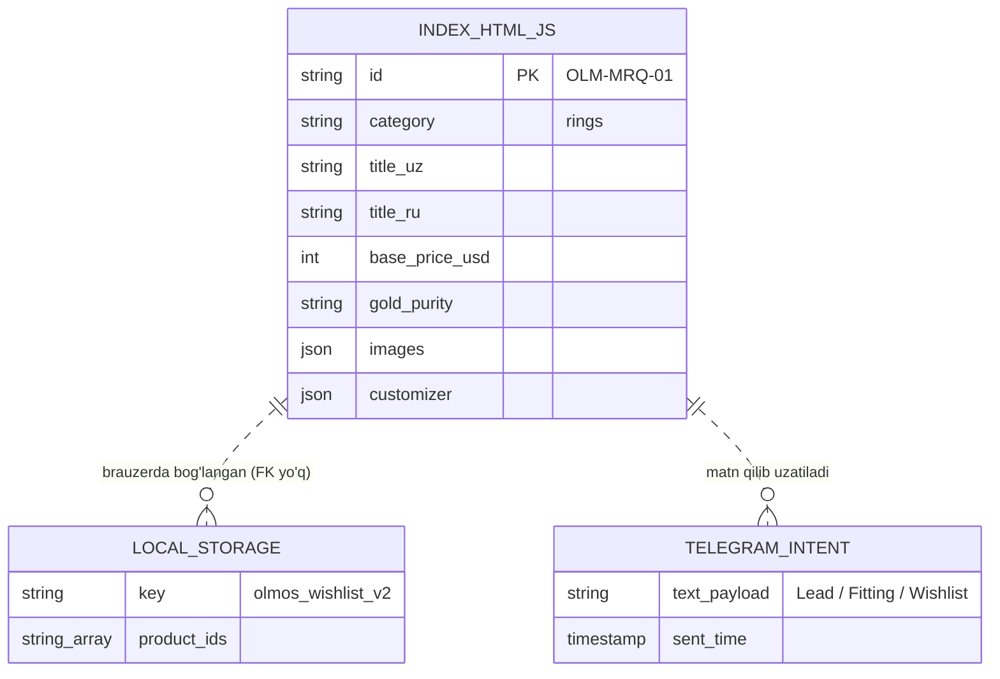
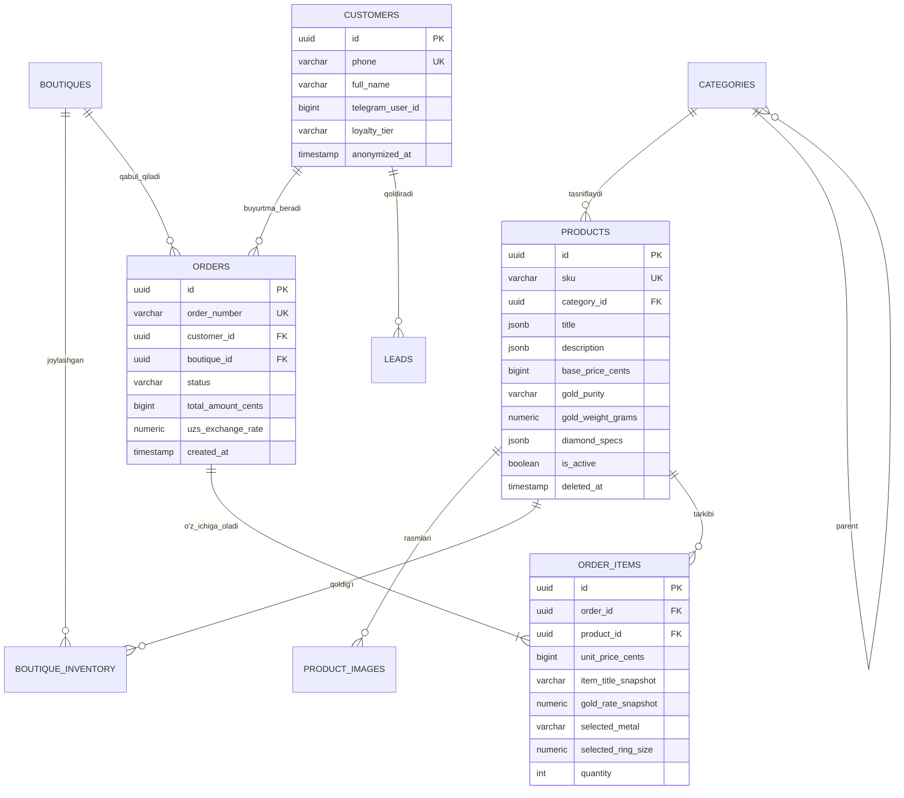

# Audit Hisoboti: Etap 8 — Ma'lumotlar Modeli, Relyatsion Arxitektura va Kelajakka Moslik
**Loyihaning turi:** Zargarlik E-tijorat Veb-ilovasi (OLMOS GOLD JEWELLERY)  
**Sana:** 2026-10-29  
**Auditor:** Principal Data Architect & Database Systems Specialist  
**Fokus:** Schema gigiyenasi, Tranzaksiyalar xavfsizligi, Zero-Downtime migratsiya, Texnik qarz qiymati

---

## 1. Kontekst Tahlili

### Hozirgi Holat (Current Schema)
Hozirgi tizimda markaziy ma'lumotlar bazasi (PostgreSQL / MySQL) mavjud emas. Butun ma'lumotlar modeli 3 ta tarqoq qismda yashaydi:
1. **Katalog (In-Memory JS Array):** `index.html` ichidagi `productsDB` massivi (12 ta mahsulot, har biri ~30 ta xususiyatga ega).
2. **Mijoz Holati (Client Browser Storage):** Brauzerning `localStorage['olmos_wishlist_v2']` kalitida faqat SKU satrlari massivi (`["OLM-MRQ-01", ...]`).
3. **Lidlar va Xaridlar (Stateless Intent Streams):** Telegram `t.me/OLMOS_GOLD` intent xabarlari orqali sotuvchining shaxsiy chatiga tushadi.

### Taxminiy O'sish Tezligi (Growth Rate)
* **Mahsulotlar katalogi:** 12 tadan yiliga 300–500 ta zargarlik buyumigacha (kam o'zgaruvchi, o'qish $99.9\%$).
* **Lidlar (VIP fitting va katalog so'rovlari):** Kuniga 15–50 ta yozuv (yiliga ~15,000 ta).
* **Buyurtmalar va tranzaksiyalar:** Kuniga 5–20 ta (yiliga ~5,000 ta buyurtma).
* **Audit va Telemetriya hodisalari:** Kuniga 1,000–5,000 ta yozuv.

### Biznesning Kengayish Yo'nalishlari
1. **Ko'p filialli savdo (Multi-boutique):** Toshkentdagi Flagship (Bunyodkor 15/1), yangi butiklar va xalqaro yetkazib berish.
2. **Real vaqtdagi qoldiq (Stock per Boutique):** Har bir butikda uzukning qaysi o'lchami va qaysi oltin rangi borligini aniq hisobga olish.
3. **Dinamik oltin va tosh narxlari:** LBMA / O'zbekiston Markaziy banki oltin kursi o'zgarishi bilan mahsulot narxining avtomatik yangilanishi.
4. **CRM va VIP Litsenziyalar:** Mijozning xarid tarixi, IGI/GIA sertifikat raqamlari pasporti, kafolat muddati va individual chegirma darajalari.

---

## 2. Hozirgi va Tavsiya Etilgan Schema Diagrammalari

### 2.1. Hozirgi Schema (Cheklangan va Tarqoq)


### 2.2. Tavsiya Etilgan Enterprise Relyatsion Schema (PostgreSQL 16+)
Tavsiya etilgan to'liq DDL skripti `migrations/001_initial_schema.sql` faylida tayyorlandi.



---

## 3. 22 Ta Savol Bo'yicha Audit Tahlili

### --- Struktura ---
1. **Primary Key Turi:** Kelajakda butiklar POS terminallari oflayn ishlaganda yoki ma'lumotlar bazalari replikatsiya qilinganda `auto-increment int` ID to'qnashuviga olib keladi. Barcha jadvallarda **UUID v7 / gen_random_uuid()** qo'llanilishi shart.
2. **Foreign Key Constraint'lar:** Hozir faqat JS massivida. DB'da qat'iy FK bo'lishi shart (`RESTRICT` va `CASCADE`).
3. **ON DELETE Xatti-harakati:**
   * `orders` mavjud bo'lgan mahsulotni bazadan o'chirib bo'lmasligi kerak (`ON DELETE RESTRICT`).
   * Mahsulot rasmlari mahsulot o'chganda birga o'chadi (`ON DELETE CASCADE`).
4. **Yetim (Orphan) Yozuvlar Xavfi:** Hozir foydalanuvchi `localStorage`ida mahsulot ID saqlanib qolib, katalogdan o'chirilsa, savatda bo'sh element paydo bo'ladi. DB'da FKlar yetim yozuvlarni butunlay istisno qiladi.
5. **Nullable Ustunlar:** Faqat ixtiyoriy maydonlar (`compare_price`, `ring_size`, `deleted_at`) nullable bo'lishi kerak; narx, SKU, unikal telefon va kategoriyalar `NOT NULL`.
6. **Enum / Statuslar:** PostgreSQL `native enum` lari kelajakda yangi status qo'shishda migratsiya cheklovlarini keltirib chiqaradi. Shuning uchun `VARCHAR(32)` + `CHECK (status IN (...))` yoki alohida lookup jadvallar ma'qul.
7. **Pul Saqlash:** **ENG KRITIK QOIDA.** Pul hech qachon `float` yoki `double` da saqlanmasligi kerak (IEEE-754 yaxlitlash xatolari tufayli tiyinlar yo'qoladi). Narxlar doimo minimal birlikda — **BIGINT (Cents/Tiyin)** yoki `NUMERIC(14, 2)` formatida saqlanadi.
8. **Sana / Vaqt:** Doimo **TIMESTAMPTZ (UTC)**. Brauzerda esa `Asia/Tashkent` vaqt zonasiga o'giriladi.
9. **Yumshoq O'chirish (Soft Delete):** Zargarlik do'konida mahsulotlar jismonan o'chirilmaydi, `deleted_at TIMESTAMPTZ` ustuni orqali arxivlanadi.
10. **Audit Maydonlari:** Har bir jadvalda `created_at`, `updated_at` bo'lishi shart.

### --- Kelajakka Moslik ---
11. **Multi-tenancy va Filiallar:** `boutiques` jadvali orqali har bir filial alohida ajratilgan. Qoldiqlar `boutique_inventory` da saqlanadi.
12. **Ko'p Tillilik (i18n):** Matnlarni `title_uz`, `title_ru` deb qotirib qo'yish o'rniga, kelajakda ingliz yoki arab tili qo'shilishi uchun `title JSONB` (`{"uz": "...", "ru": "...", "en": "..."}`) formati tanlandi.
13. **Versiyalash va Tarix (Immutable Snapshots):** Oltin narxi o'zgarsa, o'tgan oydagi buyurtma narxi o'zgarib ketmasligi kerak. `order_items` jadvali xarid vaqtidagi narx, oltin kursi va nomni to'liq "foto-snapshot" qilib saqlaydi.
14. **Denormalizatsiya:** Buyurtmaning `total_amount_cents` qiymati qulaylik uchun `orders` jadvalida saqlanadi, ammo u `order_items` yig'indisiga tengligi tranzaksiya darajasida kafolatlanadi.
15. **JSON Ustunlar:** Olmosning murakkab xususiyatlari (rang: D-F, tozalik: VVS1, sertifikat: IGI-59281) `diamond_specs JSONB` da saqlanadi va unga **GIN indeksi** qo'yiladi.
16. **Partitioning:** `audit_logs` jadvali oylar bo'yicha `PARTITION BY RANGE (created_at)` qilinadi.
17. **Zero-Downtime Migratsiyalar:** Yangi ustun qo'shish doimo `DEFAULT NULL` bilan boshlanishi kerak (Expand $\rightarrow$ Migrate $\rightarrow$ Contract).
18. **GDPR / Ma'lumotlarni O'chirish:** Mijoz shaxsiy ma'lumotlarini o'chirishni so'rasa, `customers.anonymized_at` belgilanib, telefon va ism xeshlanadi, biroq soliq va moliyaviy hisobotlar uchun buyurtmalar saqlanadi.

### --- Performance ---
19. **Indekslar:** Faqat qidiriladigan maydonlarga: `(category_id, is_active, base_price_cents)`, `sku`, `phone`.
20. **Query Tahlili:** Narx bo'yicha saralash va filtrlar indeks orqali `Index Scan` rejimida bajariladi (Seq Scan oldi olinadi).
21. **N+1 Muammosi:** Bitta mahsulotning rasmlarini tortib olishda N ta so'rov yubormaslik uchun `json_agg(images)` yoki `LEFT JOIN` aggregatsiyasi ishlatiladi.
22. **Kompozit Indeks Tartibi:** Tenglik maydonlari oldinga, oraliq (range) maydonlari orqaga qo'yilgan: `(category_id, is_active, base_price_cents)`.

---

## 4. Texnik Qarz Jadvali (Hozirgi va 1 Yildan Keyingi Narxi)

| # | Muammo | Hozirgi Xarajat (Bugun to'g'rilansa) | 1 Yildan Keyingi Xarajat (Kechiktirilsa) | Xavf Darajasi |
| :- | :--- | :--- | :--- | :---: |
| 1 | **Relyatsion Bazasiz Ishlash (Lidlar yo'qolishi)** | **2 kun** (Postgres + oddiy REST API ulash) | **$12,000+** (Mijozlar buyurtmalari yo'qolishi, Telegram bloklanganda sotuvlar to'xtashi) | **CRITICAL** |
| 2 | **Pulni Float / Matn ko'rinishida saqlash** | **2 soat** (INTEGER cents formatiga o'tkazish) | **$5,000+** (Buxgalteriya va to'lov shlyuzlari (Payme/Click) integratsiyasida balans nomutanosibligi) | **HIGH** |
| 3 | **Ko'p tillilikni `_uz`/`_ru` ustunlarga qotirish** | **3 soat** (JSONB / schema i18n tayyorlash) | **1 hafta** (Barcha jadvallarni qayta yozish, API va mobil ilovalarni yangilash) | **MEDIUM** |
| 4 | **Buyurtmalarda Snapshot Saqlamaslik** | **4 soat** (`order_items` snapshot modelini yaratish) | **Sud / Mojaro xavfi** (Mijoz 1 oy oldin $600 ga olgan uzuk narxi $800 ga oshganda eski chek narxining buzilishi) | **HIGH** |
| 5 | **Filiallar / Ombor qoldig'i modelining yo'qligi** | **1 kun** (`boutique_inventory` jadvalini ulash) | **2 hafta** (Mavjud bo'lmagan uzukni sotib qo'yish va mijoz bilan nizo) | **HIGH** |

---

## 5. Bosqichma-bosqich Zero-Downtime Migratsiya Rejasi

Eski tizimdan (statik JSON) yangi relyatsion modelga o'tish **Expand $\rightarrow$ Migrate $\rightarrow$ Contract** qoidasi bo'yicha 3 bosqichda amalga oshiriladi:

```
[ BOSQICH 1: EXPAND ]
  1. PostgreSQL 16 instansiyasini sozlash (Supabase, Neon yoki o'z serverida).
  2. `migrations/001_initial_schema.sql` skriptini ishga tushirish (jadvallar, cheklovlar, indekslar).
  3. Barcha jadvallarga xavfsiz audit triggerlarini ulash.
            │
            ▼
[ BOSQICH 2: MIGRATE ]
  4. `productsDB` massividagi 12 ta mahsulot va rasmlarni avtomatlashtirilgan script orqali DB ga yuklash.
  5. Sayt frontendi uchun `GET /api/v1/products` va `POST /api/v1/leads` engil serverless endpointlarini yoqish.
  6. Sayt avval DB'dan o'qiydi, agar DB javob bermasa — lokal JSON fallback'ka o'tadi (Zero-Downtime kafolati).
            │
            ▼
[ BOSQICH 3: CONTRACT ]
  7. Frontenddan `productsDB` statik massivini butunlay o'chirib tashlash.
  8. Eski vaqtinchalik ustunlar va zaxira fallback kodlarini tozalash.
```

* **Zero-Downtime:** Barcha o'tish davrida statik GitHub Pages sayti to'xtovsiz ishlayveradi.
* **Maintenance Window:** Faqat to'lov shlyuzi (Payme/Click) jonli ulanayotganda 10 daqiqalik sinov darchasi talab etiladi.
